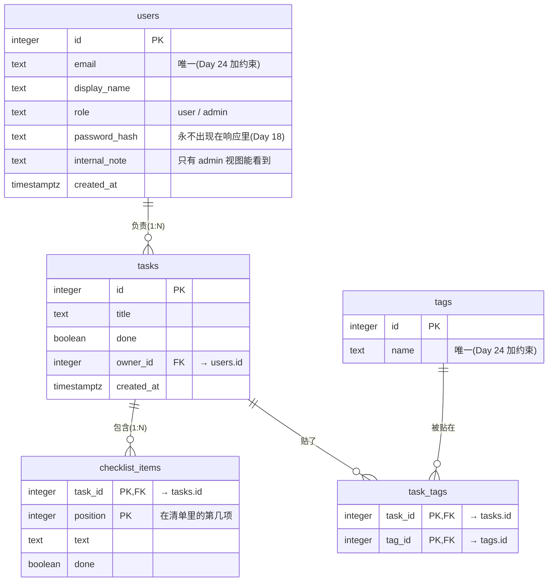

# nest-lab 数据模型(ER 图)

> Day 23 的设计稿,按 3NF 拆分。它描述「数据在数据库里怎么存」,**不是** API 的形状(API 的契约见 [`api-design.md`](api-design.md) 和 [`../openapi.json`](../openapi.json))。
> 状态:设计中。主键怎么选、NOT NULL / UNIQUE / CHECK / 外键删除行为由 Day 24 决定;Day 27 先把 `tasks` + `checklist_items` 接进 nest-lab。
> `tasks.owner_id` 和标签现在还不在 API 里:有了真正的登录用户(Week 10)才有「负责人」,标签作为多对多的例子先画进来。
> 实验用的 SQL 在 [`../sql/day23/`](../sql/day23/)(schema `day23`,字段做了简化)。

## 关系一览

| 关系 | 类型 | 怎么表达 |
|---|---|---|
| 用户 — 任务 | 1:N | `tasks.owner_id` 指向 `users.id`(「多」的一方存「一」的一方的编号) |
| 任务 — 清单项 | 1:N | `checklist_items.task_id`;清单项离开任务没有意义,主键是 `(task_id, position)` |
| 任务 — 标签 | N:M | 中间表 `task_tags (task_id, tag_id)`,一行 = 「这个任务贴了这个标签」 |

## 表 ≠ API 资源

| API 资源(Day 15 / 18) | 由哪些表拼出来 |
|---|---|
| `TaskResponse`(含 `checklist` 数组) | `tasks` + `checklist_items` |
| `TaskPage { items, nextCursor }` | `tasks` 的一次分页查询(`nextCursor` 不是任何表里的列) |
| `UserResponse`(普通视图 / admin 视图) | 同一行 `users`,按角色映射出不同字段;`password_hash` 永不出门 |

## 有意的反范式(目前没有)

如果以后要加 `users.tasks_count` 这类计数缓存,在这里登记:缓存的是什么、谁负责维护、怎么校正(见 Day 23 讲义概念卡 #3)。
