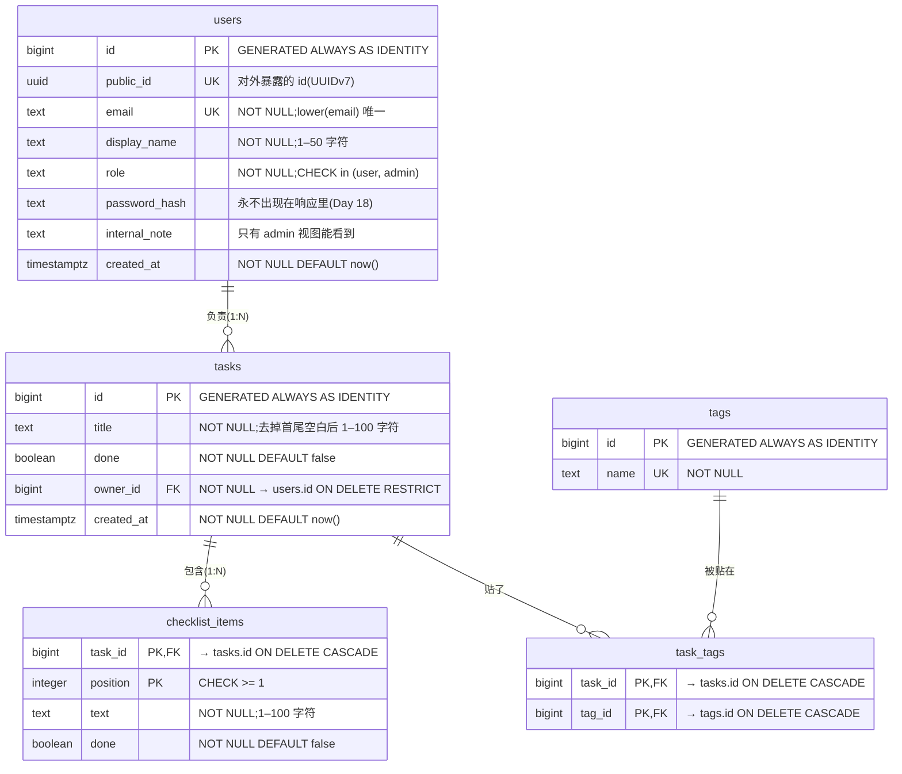

# nest-lab 数据模型(ER 图)

> Day 23 的设计稿,按 3NF 拆分。它描述「数据在数据库里怎么存」,**不是** API 的形状(API 的契约见 [`api-design.md`](api-design.md) 和 [`../openapi.json`](../openapi.json))。
> 状态:设计中。Day 24 定下了主键和约束,Day 26 定下了存储形式(见下方两节);Day 27 先把 `tasks` + `checklist_items` 接进 nest-lab。
> `tasks.owner_id` 和标签现在还不在 API 里:有了真正的登录用户(Week 10)才有「负责人」,标签作为多对多的例子先画进来。
> 实验用的 SQL:拆表过程在 [`../sql/day23/`](../sql/day23/)(schema `day23`),加上约束后的版本在 [`../sql/day24/04-constraints.sql`](../sql/day24/04-constraints.sql)(schema `day24`)。

## 主键与约束(Day 24)

| 决定 | 选择 | 理由 |
|---|---|---|
| 主键类型 | `bigint GENERATED ALWAYS AS IDENTITY` | 代理键不随业务变化;`bigint` 不会像 `integer` 那样在 21 亿处用完;`ALWAYS` 拒绝手写 id,不会和序列撞车 |
| 对外的 id | `users.public_id uuid`(UUIDv7) | 自增 id 可被枚举、会泄露业务量(Week 20 IDOR);内部关联仍用 `bigint`。任务要不要也加,Day 27 决定 |
| 邮箱唯一 | `CREATE UNIQUE INDEX users_email_lower_key ON users (lower(email))` | 不区分大小写;并发注册时只有它拦得住(先查后插拦不住) |
| `tasks.owner_id` | `ON DELETE RESTRICT` | 用户还有任务时不许直接删,先转移或删除任务;如果业务改成「保留任务、变成无人负责」,就改成 `SET NULL`(列要允许为空) |
| `checklist_items.task_id`、`task_tags.*` | `ON DELETE CASCADE` | 离开任务 / 标签就没有意义的行,跟着一起删 |
| 约束命名 | `表_列_key` / `表_列_check` / `表_列_fkey` | 违反时错误信息里带着这个名字,Day 27 按名字映射成具体的错误类型 |

### 约束违反 → HTTP 状态码(Day 27 落地)

| SQLSTATE | 名称 | 典型场景 | 映射 |
|---|---|---|---|
| `23505` | unique_violation | 邮箱已被注册 | 409(资源当前状态冲突) |
| `23503` | foreign_key_violation(插入 / 更新时) | 引用了不存在的负责人 / 标签 | 422(请求内容不合规) |
| `23503` | foreign_key_violation(删除时) | 删除仍被引用的用户(RESTRICT) | 409 |
| `23502` | not_null_violation | 必填字段没给 | 422,并记一条警告日志:DTO 校验本该先拦住 |
| `23514` | check_violation | 标题全空白、角色不在白名单 | 422,同上 |

## 存储形式的决定(Day 26)

| 数据 | 决定 | 理由 |
|---|---|---|
| 任务的清单 `checklist` | **子表 `checklist_items`**(不用 JSONB 列) | ① 每一项都有自己的规则(`text` 非空、1–100 字,`done` 是布尔),子表能用约束逐项把关,JSONB 里写 `{"done": "maybe"}` 数据库照收;② 列表页要「清单完成 2/3」、Day 25 那类「清单里有牛奶的任务」统计,在子表上是普通的 `count` / `JOIN`;③ API 要的 `checklist: [...]` 形状是映射问题(Day 18),仓储可以一条查询用 `json_agg(... ORDER BY position)` 拼出来。代价:创建 / 整体替换任务时要在**同一个事务**里写两张表(Day 27 用 `BEGIN … COMMIT`,原理 Week 6) |
| 任务的标签 | **中间表 `task_tags` + `tags`**(不用 `text[]`) | 标签改名只改一行;能统计每个标签的使用次数;有外键,写不进不存在的标签。数组适合「不需要改名、不需要关联、只跟着这一行」的简单值 |
| 附属数据(来源、客户端信息、第三方回调原文) | 将来需要时用 **`jsonb` 列**(如 `tasks.metadata`) | 结构多变、只跟着这一行读写、不需要外键 / 唯一 / 频繁按字段过滤。目前 nest-lab 没有这类数据,先不加 |
| 所有时间 | **`timestamptz`** | 存的是绝对时刻;应用层统一输出 ISO 8601 UTC(Day 18 的 `createdAt`),展示时再按用户时区转换。`timestamp`(不带时区)只存墙上时间,不知道是哪里的几点 |
| 取值固定的状态 | **`CHECK (… IN …)`**(如 `users.role`) | `CREATE TYPE … AS ENUM` 加值容易、删值没有语法;CHECK 改起来就是换一条约束 |

## 关系一览

| 关系 | 类型 | 怎么表达 |
|---|---|---|
| 用户 — 任务 | 1:N | `tasks.owner_id` 指向 `users.id`(「多」的一方存「一」的一方的编号) |
| 任务 — 清单项 | 1:N | `checklist_items.task_id`;清单项离开任务没有意义,主键是 `(task_id, position)` |
| 任务 — 标签 | N:M | 中间表 `task_tags (task_id, tag_id)`,一行 = 「这个任务贴了这个标签」 |

## 表 ≠ API 资源

| API 资源(Day 15 / 18) | 由哪些表拼出来 |
|---|---|
| `TaskResponse`(含 `checklist` 数组) | `tasks` + `checklist_items` |
| `TaskPage { items, nextCursor }` | `tasks` 的一次分页查询(`nextCursor` 不是任何表里的列) |
| `UserResponse`(普通视图 / admin 视图) | 同一行 `users`,按角色映射出不同字段;`password_hash` 永不出门 |

## 有意的反范式(目前没有)

如果以后要加 `users.tasks_count` 这类计数缓存,在这里登记:缓存的是什么、谁负责维护、怎么校正(见 Day 23 讲义概念卡 #3)。
